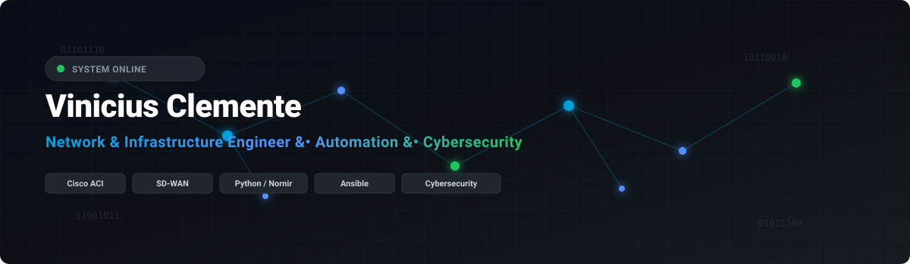

  

# 💫 About Me

### Hi there, I'm Vinicius Clemente 👋

**Network & Infrastructure Engineer | Network Automation | Cybersecurity Practitioner**

---

### 📬 Summary

- 🛠️ Currently focusing on **Enterprise Network Architecture**, **Data Center Architecture (Cisco ACI)**, **SD-WAN**, and **Network Automation**.
- 🛡️ Operating across multi-vendor Security & Networking platforms (**Cisco, Huawei, Check Point, Fortinet, F5 BIG-IP, Juniper, pfSense**).
- 🐍 Developing Python tools using **Netmiko**, **Paramiko**, and **Nornir** to automate multi-vendor environments.
- ⚡ Deepening skills in **Ethical Hacking**, **Traffic Analysis**, and **Reconnaissance**.
- 📍 Based in **Brazil** 🇧🇷

---

### 💻 Tech Stack & Tools

**Networking & Security:**

**Automation, Systems & Cloud:**

---

### 📊 GitHub Stats

  

  

---

  

